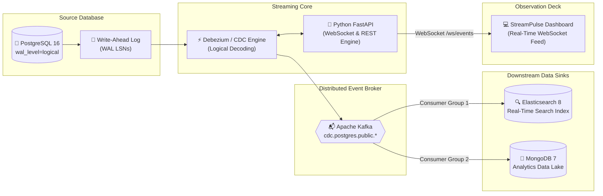

# StreamPulse CDC (CDC Stream)
### Real-Time Database Change Data Capture & Streaming Platform

> **Capture real-time changes from a database (insert, update, delete) and stream them to a search index or analytics database.**

[](https://fastapi.tiangolo.com)
[](https://www.postgresql.org)
[](https://kafka.apache.org)
[](https://www.elastic.co)
[](https://www.mongodb.com)
[](https://www.docker.com)

---

## 📌 Project Overview & Suggested Names

| Proposal | Project Name | Focus |
|---|---|---|
| **Primary (Recommended)** | **StreamPulse CDC** | Enterprise-grade, modern real-time streaming identity |
| **Exact Mockup Match** | **CDC Stream** | Direct representation of the application interface shown in the post |
| **Alternative** | **FlowSync CDC** | Focus on bi-directional data flow and real-time synchronization |

**StreamPulse CDC** is an end-to-end Change Data Capture (CDC) platform that captures database transactions (INSERT, UPDATE, DELETE) directly from PostgreSQL's Write-Ahead Log (WAL) using logical replication, serializes them into standardized Debezium/Kafka event envelopes, and streams them with sub-5ms latency into downstream search indices (**Elasticsearch**) and analytics data lakes (**MongoDB**).

---

## 🏛 Architecture Diagram



---

## 🛠 Tech Stack

| Technology | Role in Architecture |
|---|---|
| **PostgreSQL 16** | Source relational database. Uses `wal_level=logical` and `REPLICA IDENTITY FULL` to preserve before-and-after snapshots of every mutation. |
| **Apache Kafka** | Distributed commit log and event bus. Decouples the database WAL from downstream consumers, offering fault-tolerant message streaming and replayability. |
| **MongoDB 7.0** | Document database acting as an analytics data lake for historical reporting, aggregation, and time-series rollups. |
| **Elasticsearch 8.13** | Distributed JSON search engine for sub-second full-text queries and indexing over operational data. |
| **Python (FastAPI)** | CDC processing engine, WebSocket broadcasting server, schema registry, and REST API controller. |
| **Docker & Compose** | Containerized multi-service orchestration for reproducible local and cloud deployment. |

---

## ✨ Features

- **Real-Time Live Event Stream**: Instant WebSocket-driven dashboard displaying incoming CDC events as they happen with glowing operation badges (`INSERT`, `UPDATE`, `DELETE`).
- **Live Sparkline Bar Charts**: Real-time metric cards tracking Total, Insert, Update, and Delete operations.
- **Interactive Mutation Simulator**: Trigger instant `INSERT`, `UPDATE`, or `DELETE` mutations across tables (`users`, `orders`, `products`, `payments`, `inventory`) and inspect the generated WAL event.
- **Debezium Envelope Inspector**: Slide-over drawer detailing the WAL Log Sequence Number (LSN), Transaction ID, Kafka topic & partition, pipeline latency, and Before/After diff.
- **Kafka Consumer Group Monitor**: Real-time consumer lag metrics, partition offsets, and rebalance states.
- **PostgreSQL Schema Registry**: Catalog of replicated tables, column data types, nullability, and replica identity settings.
- **Pipeline Topology & Connectors**: Interactive connector controls allowing you to pause, resume, and monitor throughput (EPS).
- **Harmonic Audio Blips**: Optional synthesized Web Audio feedback on every mutation.

---

## 🚀 Quickstart Guide

### Option 1: Run Locally with Python (Instant)

1. **Install dependencies**:
   ```bash
   pip install -r backend/requirements.txt
   ```

2. **Start the CDC Platform**:
   ```bash
   python run.py
   # Or on Windows:
   start.bat
   ```

3. **Open the Dashboard**:
   Navigate to [http://localhost:8000](http://localhost:8000) in your web browser.

---

### Option 2: Run the Full Containerized Stack with Docker Compose

To run PostgreSQL, Kafka, Zookeeper, Elasticsearch, MongoDB, and the CDC Platform together:

```bash
docker compose up -d
```

Services will be accessible at:
- **Dashboard & API**: [http://localhost:8000](http://localhost:8000)
- **API Documentation**: [http://localhost:8000/docs](http://localhost:8000/docs)
- **PostgreSQL**: `localhost:5432` (`cdc_user` / `cdc_password`)
- **Kafka Broker**: `localhost:9092`
- **Elasticsearch**: `http://localhost:9200`
- **MongoDB**: `localhost:27017`

---

## 📡 API Endpoints

| Method | Endpoint | Description |
|---|---|---|
| `GET` | `/api/metrics` | Returns aggregated metrics, counts, and sparklines |
| `GET` | `/api/events` | Paginated, filterable CDC event stream |
| `POST` | `/api/mutate` | Simulates an interactive database table mutation |
| `POST` | `/api/batch` | Emits a synthetic high-throughput traffic spike |
| `GET` | `/api/connectors` | Telemetry for Source, Broker, and Sink connectors |
| `POST` | `/api/connectors/{id}/toggle` | Pauses or resumes an individual connector |
| `GET` | `/api/consumers` | Kafka consumer group offsets and lag statistics |
| `GET` | `/api/schemas` | Table schema registry and replica identity settings |
| `WS` | `/ws/events` | Real-time bidirectional WebSocket stream |

---

## 📦 Project Structure

```
Project-1/
├── backend/
│   ├── main.py            # FastAPI app, REST routes, WebSocket broadcaster
│   ├── cdc_engine.py      # Core CDC simulator, WAL replication, event buffer
│   ├── models.py          # Pydantic schemas for events, metrics, schemas
│   └── requirements.txt   # Python dependencies
├── frontend/
│   ├── index.html         # High-fidelity dashboard UI matching mockup
│   ├── css/
│   │   └── style.css      # Dark-mode design system & animations
│   └── js/
│       └── app.js         # Reactive WebSocket client, drawer, audio synthesizer
├── init-scripts/
│   └── init-cdc.sql       # PostgreSQL DDL, logical publication & replica identities
├── Dockerfile             # Production container definition
├── docker-compose.yml     # Multi-service stack (PG, Kafka, Mongo, ES, App)
├── run.py                 # Direct local runner
├── start.bat              # Windows one-click starter
└── README.md              # Documentation & Architecture guide
```
